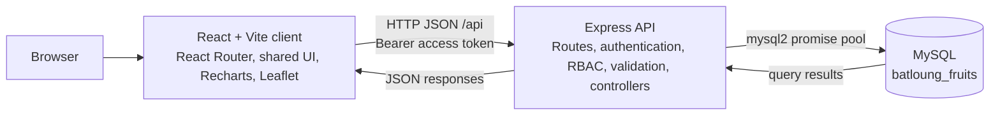

# System architecture

The React single-page client sends authenticated JSON requests to the Express API. Express routes apply authentication, role authorization and request validation before controllers use the MySQL connection pool.

The server owns business rules and permissions. The client uses role-based navigation to reflect those permissions, but the API is authoritative. Dashboard and report endpoints are Administrator-only; Sales sees only operational dashboard data obtainable from Sales-authorized endpoints. See [the ER diagram](erd.md) and [API reference](api-reference.md).
