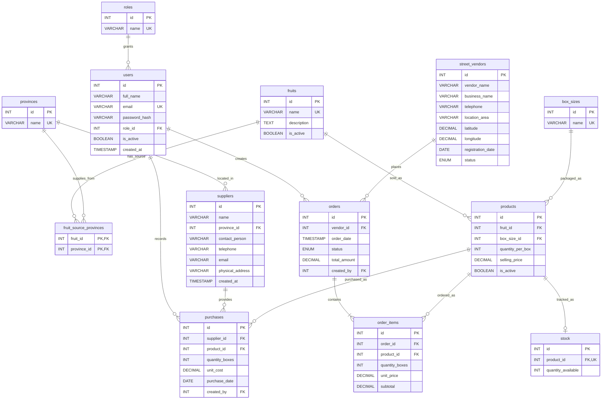

# Entity relationship diagram

This diagram reflects the tables, primary keys and foreign-key relationships in [`database/schema.sql`](../database/schema.sql).

The `fruit_source_provinces` table joins fruits to allowed source provinces. A product has at most one stock row, enforced by the unique key on `stock.product_id`.
