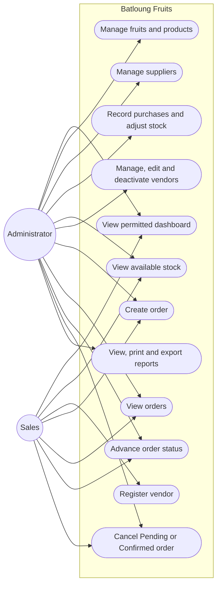

# Role use cases

Administrator and Sales actions shown here reflect the route authorization and order-status rules in the application.

Sales dashboard access excludes supplier totals, sales value and sales charts. Sales can view fruit and product records but cannot manage them; these read-only uses are reflected in the application navigation rather than as separate use-case bubbles.
